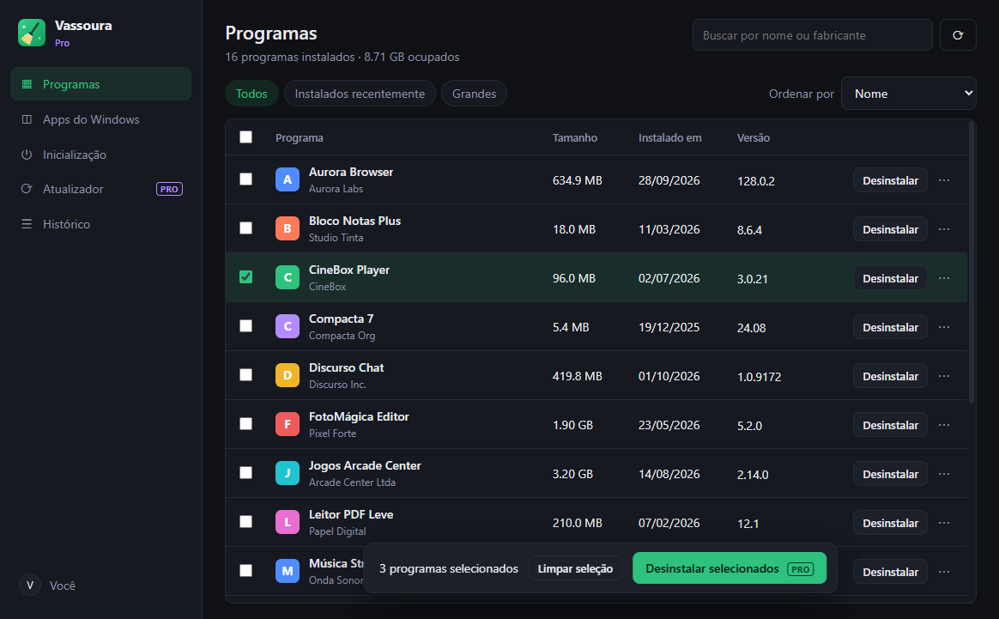
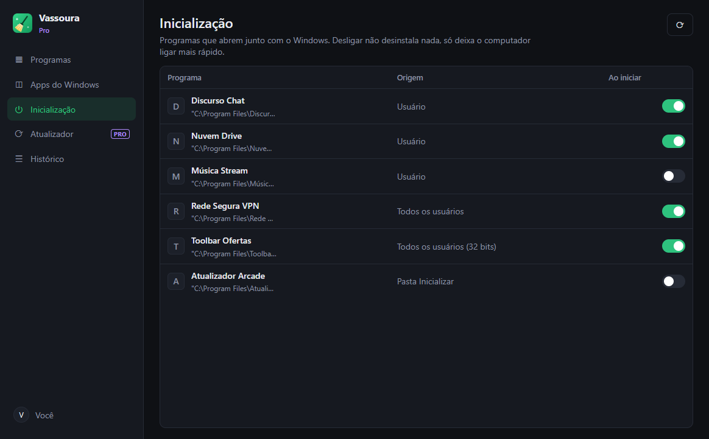
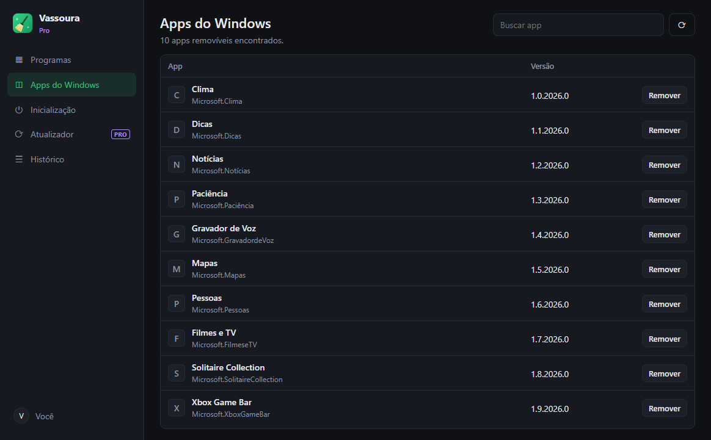

<h1 align="center">Vassoura</h1>

<b>Desinstalou? Então some de verdade.</b> 
Desinstalador para Windows que remove o programa e varre tudo o que ele deixa para trás.

  <a href="https://vassoura-app.netlify.app/#baixar"><b>⬇ Baixar grátis</b></a> ·
  <a href="https://vassoura-app.netlify.app/#precos">Planos</a> ·
  <a href="https://github.com/srlorenzos/vassoura/issues/new/choose">Suporte</a> ·
  <a href="CHANGELOG.md">Novidades</a>

> Esta é a página pública do Vassoura: demonstração, novidades e suporte. O código-fonte do app é privado.

## O que ele faz

| | |
|---|---|
| 🧹 **Limpeza de sobras** | Depois de desinstalar, procura pastas, atalhos e registros que ficaram para trás e mostra tudo antes de apagar. |
| 🛟 **Seguro por padrão** | Ponto de restauração antes de cada remoção, arquivos vão para a Lixeira e o registro ganha backup `.reg`. |
| 📦 **Desinstalação em lote** `PRO` | Marque vários programas e remova todos de uma vez, em modo silencioso quando possível. |
| 💥 **Remoção forçada** `PRO` | Para programas sem desinstalador ou com desinstalador quebrado. |
| ⟳ **Atualizador** `PRO` | Encontra versões novas dos seus programas e atualiza com um clique. |
| ⚡ **Inicialização e apps** | Desliga o que abre com o Windows e remove apps da Microsoft Store que vieram de fábrica. |

### Sobras encontradas depois de desinstalar

### Desinstalação em lote

### Atualizador, inicialização e apps do Windows

  
  
  

*As capturas usam o modo demonstração, com programas fictícios.*

## Planos

| | Grátis | Pro Anual | Pro Vitalício |
|---|:-:|:-:|:-:|
| Preço | R$ 0 | R$ 39,90/ano | R$ 89,90 uma vez |
| Desinstalar + varredura básica | ✓ | ✓ | ✓ |
| Varredura profunda (AppData, ProgramData, registro) | – | ✓ | ✓ |
| Desinstalação em lote | – | ✓ | ✓ |
| Remoção forçada | – | ✓ | ✓ |
| Atualizador de programas | – | ✓ | ✓ |
| Computadores | ilimitado | 3 | 5 |

Compre em **[vassoura-app.netlify.app](https://vassoura-app.netlify.app/#precos)**, entre no app com o mesmo e-mail e clique em *Atualizar licença*.

## Requisitos

Windows 10 ou 11, 64 bits. O app pede permissão de administrador porque precisa disso para remover programas instalados para todos os usuários.

Na primeira execução, o Windows pode mostrar o aviso *"O Windows protegeu o computador"*. Clique em **Mais informações › Executar assim mesmo**.

## Suporte

Achou um problema ou tem uma ideia? [Abra uma issue](https://github.com/srlorenzos/vassoura/issues/new/choose).
