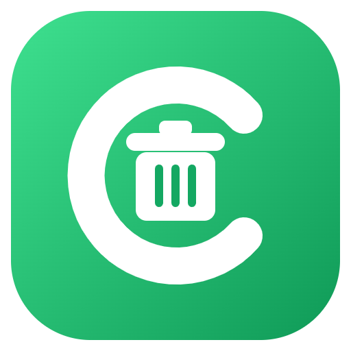
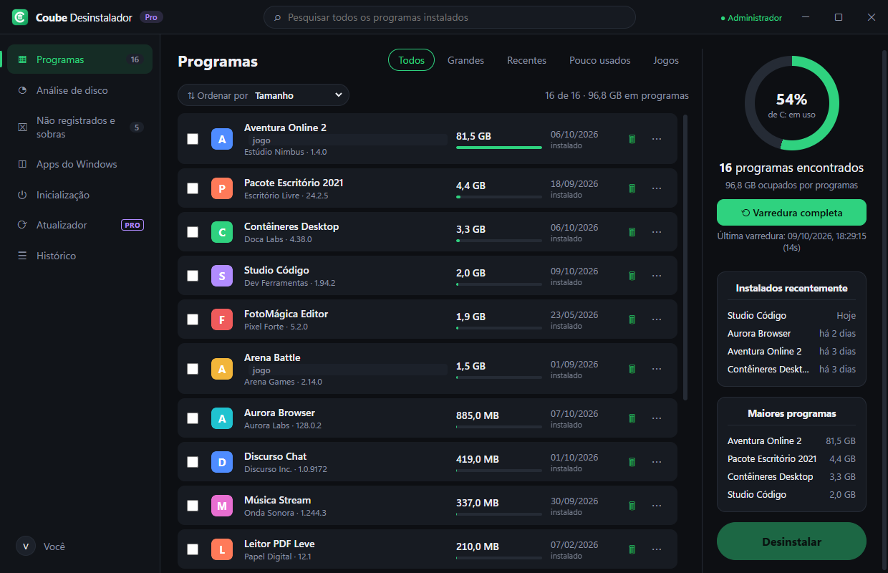
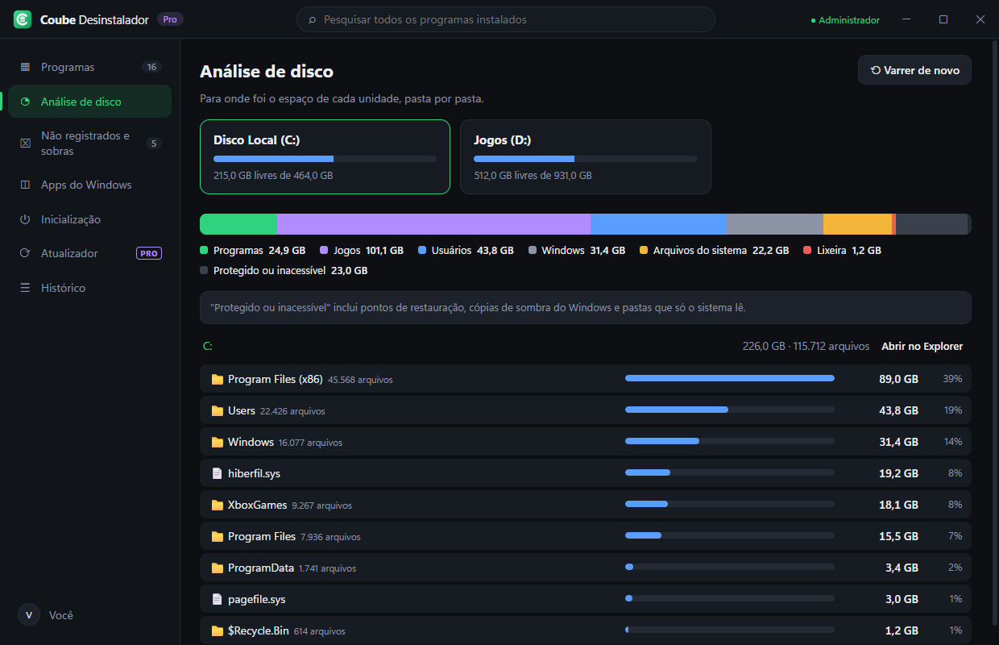

<h1 align="center">Coube Desinstalador</h1>

<b>Desinstalou? Então some de verdade.</b> 
Vasculha o computador inteiro, mostra o tamanho real de cada programa e remove tudo o que eles deixam para trás. 
Primeiro app da <b>Coube Solutions</b>.

  <a href="https://github.com/srlorenzos/coube-desinstalador/releases/latest"><b>⬇ Baixar grátis</b></a> ·
  <a href="https://coube-solutions.netlify.app/#precos">Planos</a> ·
  <a href="https://github.com/srlorenzos/coube-desinstalador/issues/new/choose">Suporte</a> ·
  <a href="CHANGELOG.md">Novidades</a>

> Esta é a página pública do Coube Desinstalador: demonstração, novidades e suporte. O código-fonte é privado. Antes ele se chamava **Vassoura**.

## O que ele faz

| | |
|---|---|
| 🔎 **Varredura completa** | Encontra programas do Windows, Steam, Epic, Xbox e da Store, mede o tamanho real de cada pasta e mostra o último uso. |
| ◔ **Análise de disco** | Para onde foi o espaço de cada unidade: programas, jogos, usuários, Windows e arquivos do sistema, pasta por pasta. |
| 🧹 **Limpeza de sobras** | Depois de desinstalar, procura pastas, atalhos e registros que ficaram para trás e mostra tudo antes de apagar. |
| ⌧ **Não registrados e sobras antigas** | Programas copiados sem instalador e dados de programas que já foram removidos. |
| 🛟 **Seguro por padrão** | Ponto de restauração antes, arquivos vão para a Lixeira e o registro ganha backup `.reg`. |
| 📦 **Lote, forçada e atualizador** `PRO` | Remova vários de uma vez, force os teimosos e mantenha tudo atualizado. |

### Análise de disco

### Sobras encontradas depois de desinstalar

### Não registrados e sobras antigas

  
  

*As capturas usam o modo demonstração, com programas fictícios.*

## Planos

| | Grátis | Coube Pro Anual | Coube Pro Vitalício |
|---|:-:|:-:|:-:|
| Preço | R$ 0 | R$ 39,90/ano | R$ 89,90 uma vez |
| Desinstalar + sobras básicas | ✓ | ✓ | ✓ |
| Varredura completa e análise de disco | ✓ | ✓ | ✓ |
| Sobras profundas (AppData, ProgramData, registro) | – | ✓ | ✓ |
| Desinstalação em lote e remoção forçada | – | ✓ | ✓ |
| Remover não registrados e sobras antigas | – | ✓ | ✓ |
| Atualizador de programas | – | ✓ | ✓ |
| Todos os próximos apps Coube | – | ✓ | ✓ |
| Computadores | ilimitado | 3 | 5 |

## Requisitos

Windows 10 ou 11, 64 bits. O app pede permissão de administrador, porque precisa dela para vasculhar o disco inteiro e remover programas instalados para todos os usuários.

Na primeira execução, o Windows pode mostrar *"O Windows protegeu o computador"*. Clique em **Mais informações › Executar assim mesmo**.

## Suporte

Achou um problema ou tem uma ideia? [Abra uma issue](https://github.com/srlorenzos/coube-desinstalador/issues/new/choose).
